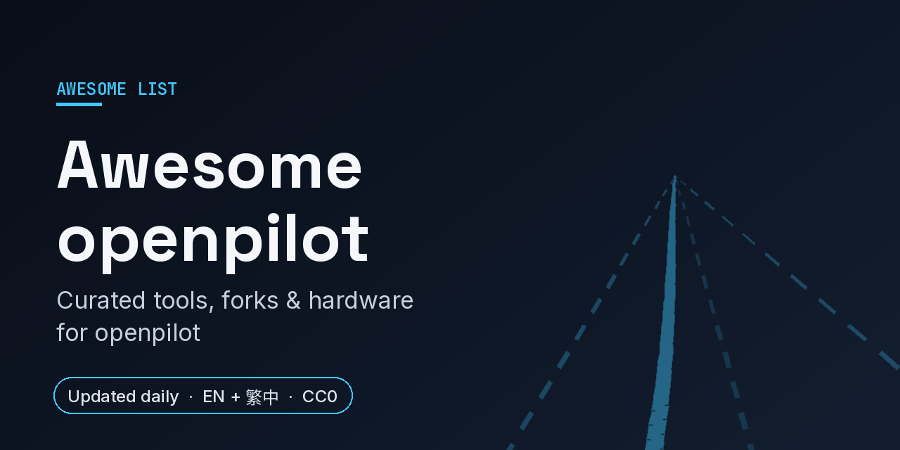

# Awesome openpilot 

   

English | [繁體中文](README.zh-TW.md)

> A curated map of the openpilot ecosystem: forks, car ports, CAN/DBC tools, hardware, data tools, models and docs.

**Status:** Curated 2026-10. Contributions welcome.

**Disclaimer:** openpilot and its forks are **driver assistance (Level 2)**, not self-driving. You must stay attentive with hands ready at all times. Installing or modifying it is your own responsibility; follow your local laws and regulations. Forks listed here are not endorsed by comma.ai or by this list.

---

## Start here

The projects people actually share. Everything below is the map around them, not a product catalog.

- **[sunnypilot](https://github.com/sunnypilot/sunnypilot)** — Open-source driver assistance fork of openpilot with extra features and car support.
- **[FrogPilot](https://github.com/FrogAi/FrogPilot)** — Highly customizable, community-driven openpilot fork.
- **[dragonpilot](https://github.com/dragonpilot/dragonpilot)** — Long-running openpilot-based driver assistance fork.
- **[openpilot-cabana](https://github.com/deanlee/openpilot-cabana)** — Standalone CAN / CAN FD analyzer for reverse engineering, from the Cabana lineage.
- **[Openpilot-Deepdive](https://github.com/OpenDriveLab/Openpilot-Deepdive)** — Research deep dive into how openpilot's driving model works.

---

## New this week

Added between 2026-10-15 and 2026-10-21 (derived from git history).

- **[edgepilot](https://github.com/cwal1220/edgepilot)** — openpilot driving model and lateral control on a Sipeed MaixCAM2 (AX630C NPU), with Panda CAN. _(Hardware & ports)_
- **[End-To-End-Self-Driving](https://github.com/Sontran0118/End-To-End-Self-Driving)** — openpilot on Jetson Orin Nano for a 2023 Mazda CX-5 via a DIY STM32F407 panda. _(Hardware & ports)_
- **[AutoDistill](https://github.com/bbbenji/AutoDistill)** — Automatic CAN reverse engineering for openpilot car ports from captures. _(CAN, DBC & data tools)_
- **[panda-socketcan](https://github.com/I-CAN-hack/panda-socketcan)** — CANnectivity firmware for comma.ai White, Black and Red pandas that exposes their CAN channels through Linux's gs_usb SocketCAN driver. _(CAN, DBC & data tools)_
- **[sunnyconf-app](https://github.com/Falseclock/sunnyconf-app)** — Native Android client for sunnyconf: configure a sunnypilot device and browse drives over local WiFi. _(Dashcam, UI & companions)_
- **[roadviewer-ha](https://github.com/Qualified4/roadviewer-ha)** — Home Assistant app to upload and replay openpilot logs with synced video, lanes and radar. _(Dashcam, UI & companions)_
- **[delamain](https://github.com/vonhex/delamain)** — Self-hosted AI vehicle companion for sunnypilot on comma hardware (voice and telemetry). _(Dashcam, UI & companions)_
- **[oceanfront-view](https://github.com/moistpope/oceanfront-view)** — Tesla-style HUD for the Fisker Ocean center screen, fed live by a comma device running sunnypilot. _(Dashcam, UI & companions)_

5 more added this week

- **[comma-analytics](https://github.com/clickityclickclickclick/comma-analytics)** — Self-hosted Grafana dashboard for comma / openpilot drives. _(Self-hosted backends & installers)_
- **[openpilot-local-finetune](https://github.com/klebeer/openpilot-local-finetune)** — Fine-tune openpilot driving models on your own drives, on a laptop. _(Models, training & research)_
- **[openpilot_carla_model_finetuner](https://github.com/jagoff2/openpilot_carla_model_finetuner)** — Collect lane-centering examples in CARLA, fine-tune openpilot driving models and export them for comma 3X. _(Models, training & research)_
- **[openpilot-desktop](https://github.com/luzijun360/openpilot-desktop)** — Run the openpilot driving model on a dashcam video on Mac or Windows, with comma-style lane and path overlays. _(Models, training & research)_
- **[mqb-eps-research](https://github.com/brendanballon/mqb-eps-research)** — Offline research into VW MQB power-steering firmware to improve openpilot steering authority and response; no vehicle-tested change yet. _(Models, training & research)_

---

## Contents

- [At a glance](#at-a-glance)
- [Core (comma.ai)](#core-commaai)
- [Forks & distributions](#forks--distributions)
- [Hardware & ports](#hardware--ports)
- [CAN, DBC & data tools](#can-dbc--data-tools)
- [Dashcam, UI & companions](#dashcam-ui--companions)
- [Self-hosted backends & installers](#self-hosted-backends--installers)
- [Models, training & research](#models-training--research)
- [Docs & learning](#docs--learning)
- [Closed-source / commercial (for reference)](#closed-source--commercial-for-reference)
- [Related lists](#related-lists)
- [Contributing](#contributing)
- [License](#license)

---

## At a glance

### Major forks

Taken from each project's README and GitHub on 2026-10-21. Forks change fast, so check the project itself before installing.

| Project | Relationship to openpilot | License (GitHub) | Devices named in README | Install / docs |
|---|---|---|---|---|
| [openpilot](https://github.com/commaai/openpilot) | Upstream (comma.ai) | MIT | comma four; comma 3X branches listed | Install URL `openpilot.comma.ai` · [docs.comma.ai](https://docs.comma.ai) |
| [sunnypilot](https://github.com/sunnypilot/sunnypilot) | Fork of openpilot | MIT | Not stated | [docs.sunnypilot.ai](https://docs.sunnypilot.ai/) · [community forum](https://community.sunnypilot.ai/) |
| [FrogPilot](https://github.com/FrogAi/FrogPilot) | Community-driven fork | MIT | comma 3 / 3X | Install URL `frogpilot.download` · [FrogPilot wiki](https://frogpilot.com/wiki/) |
| [dragonpilot](https://github.com/dragonpilot/dragonpilot) | Built on openpilot | MIT | comma 3 / 3X and O3 / O3L / O3XL; EON / C2 on the `d2` branch | [English README](https://github.com/dragonpilot/dragonpilot/blob/pre-build/README_EN.md) |
| [StarPilot](https://github.com/firestar5683/StarPilot) | Custom fork | MIT; README notes adapted sunnypilot code under a custom notice | comma 3, 3X and 4 | [wiki.firestar.link](https://wiki.firestar.link) |

## Core (comma.ai)

- **[openpilot](https://github.com/commaai/openpilot)** — The upstream project.
- **[opendbc](https://github.com/commaai/opendbc)** — Python API and DBC files for car CAN buses.
- **[panda](https://github.com/commaai/panda)** — Firmware for the panda CAN interface.
- **[connect](https://github.com/commaai/connect)** — Web app to manage devices and routes.
- **[comma-steering-control](https://github.com/commaai/comma-steering-control)** — Steering measurement dataset (~12,500 h).

## Forks & distributions

- **[sunnypilot](https://github.com/sunnypilot/sunnypilot)** — Feature-rich fork with broad car support.
- **[FrogPilot](https://github.com/FrogAi/FrogPilot)** — Customizable community fork.
- **[FrogPilot-Resources](https://github.com/FrogAi/FrogPilot-Resources)** — Models, themes and assets FrogPilot downloads.
- **[dragonpilot](https://github.com/dragonpilot/dragonpilot)** — openpilot-based driver assistance fork.
- **[StarPilot](https://github.com/firestar5683/StarPilot)** — Monthly-updated open-source fork.
- **[openpilot](https://github.com/j-vanetten/openpilot)** — jvePilot: FCA/Stellantis hybrid openpilot + ACC.
- **[openpilot](https://github.com/BogGyver/openpilot)** — Fork for pre-AP / AP1 / AP2 Tesla cars.
- **[zoompilot](https://github.com/zoompilot/zoompilot)** — Driver assistance fork focused on Mazda.
- **[openpilot](https://github.com/crwusiz/openpilot)** — Community fork popular with Korean users.
- **[openpilot](https://github.com/kisapilot/openpilot)** — Community fork (Korea).
- **[openpilot](https://github.com/jixiexiaoge/openpilot)** — Merges features from several forks.
- **[flowpilot](https://github.com/flowdriveai/flowpilot)** — openpilot-based system that runs on Android phones.

## Hardware & ports

- **[RKPilot](https://github.com/MM-X/RKPilot)** — openpilot hardware/software on RK3588 / Orange Pi.
- **[jetlink](https://github.com/zoompilot/jetlink)** — Runs the openpilot driving model on Jetson Orin Nano, macOS, iOS.
- **[openpilot-ext-radar-addon](https://github.com/eFiniLan/openpilot-ext-radar-addon)** — External radar add-on for longitudinal control.
- **[BrakeModule](https://github.com/killinen/BrakeModule)** — Brake control module for BMW E39 with Bosch DSC.
- **[c3-faux-touch-keyboard](https://github.com/nelsonjchen/c3-faux-touch-keyboard)** — Cheap macro keyboard firmware to tap the comma 3 screen.
- **[mount-install-templates](https://github.com/ophwug/mount-install-templates)** — Mount install templates for comma three / 3X / four.
- **[ars510-radar](https://github.com/ds-sebastian/ars510-radar)** — Decoder and installer for the Continental ARS510 front radar on radar-ACC Toyotas (RAV4 2022+, C-HR, Yaris).
- **[edgepilot](https://github.com/cwal1220/edgepilot)** — openpilot driving model and lateral control on a Sipeed MaixCAM2 (AX630C NPU), with Panda CAN.
- **[End-To-End-Self-Driving](https://github.com/Sontran0118/End-To-End-Self-Driving)** — openpilot on Jetson Orin Nano for a 2023 Mazda CX-5 via a DIY STM32F407 panda.

## CAN, DBC & data tools

- **[openpilot-cabana](https://github.com/deanlee/openpilot-cabana)** — CAN / CAN FD bus analyzer.
- **[PlotJuggler](https://github.com/PlotJuggler/PlotJuggler)** — Time-series visualizer commonly used with openpilot logs.
- **[CanLab](https://github.com/Sherin-SEF-AI/CanLab)** — PyQt6 desktop app for reverse-engineering CAN captures.
- **[strym](https://github.com/jmscslgroup/strym)** — Real-time CAN logging, analysis and visualization.
- **[make_cabana_route](https://github.com/projectgus/make_cabana_route)** — Convert local CAN logs into Cabana routes.
- **[OpenpilotToolkit](https://github.com/spektor56/OpenpilotToolkit)** — Toolkit and library for interacting with openpilot devices.
- **[pandacapture](https://github.com/suburbazine/pandacapture)** — CAN capture, live dashboard and firmware flashing for comma Red / Black Panda.
- **[AutoDistill](https://github.com/bbbenji/AutoDistill)** — Automatic CAN reverse engineering for openpilot car ports from captures.
- **[panda-socketcan](https://github.com/I-CAN-hack/panda-socketcan)** — CANnectivity firmware for comma.ai White, Black and Red pandas that exposes their CAN channels through Linux's gs_usb SocketCAN driver.

## Dashcam, UI & companions

- **[comma-sync](https://github.com/sourylime/comma-sync)** — Sync and stitch comma dashcam footage into videos.
- **[opview](https://github.com/eFiniLan/opview)** — openpilot onroad UI over WebRTC on your phone.
- **[Comma4-UI-Streamer](https://github.com/peterclampton/Comma4-UI-Streamer)** — MJPEG stream of the comma 4 UI for any browser.
- **[OpenPilotSiriShortcuts](https://github.com/twilsonco/OpenPilotSiriShortcuts)** — iOS Shortcuts to set navigation destinations.
- **[eon-custom-themes](https://github.com/Coltonton/eon-custom-themes)** — Custom boot logos and themes for EON / LEON / Two.
- **[sunnyconf](https://github.com/Falseclock/sunnyconf)** — On-device daemon to edit sunnypilot params over local WiFi from an Android app.
- **[sunnyconf-app](https://github.com/Falseclock/sunnyconf-app)** — Native Android client for sunnyconf: configure a sunnypilot device and browse drives over local WiFi.
- **[roadviewer-ha](https://github.com/Qualified4/roadviewer-ha)** — Home Assistant app to upload and replay openpilot logs with synced video, lanes and radar.
- **[delamain](https://github.com/vonhex/delamain)** — Self-hosted AI vehicle companion for sunnypilot on comma hardware (voice and telemetry).
- **[oceanfront-view](https://github.com/moistpope/oceanfront-view)** — Tesla-style HUD for the Fisker Ocean center screen, fed live by a comma device running sunnypilot.

## Self-hosted backends & installers

- **[connect-killer](https://github.com/MoreTore/connect-killer)** — Self-hosted backend for openpilot connectivity.
- **[retropilot-server](https://github.com/florianbrede-ayet/retropilot-server)** — Replacement for the comma backend and dashboard.
- **[openpilot-installer-generator](https://github.com/sshane/openpilot-installer-generator)** — Generates custom fork installer binaries.
- **[comma-analytics](https://github.com/clickityclickclickclick/comma-analytics)** — Self-hosted Grafana dashboard for comma / openpilot drives.

## Models, training & research

- **[Openpilot-Deepdive](https://github.com/OpenDriveLab/Openpilot-Deepdive)** — Deep dive into the driving model.
- **[openpilot.distill](https://github.com/YassineYousfi/openpilot.distill)** — Distill openpilot using your own drives.
- **[openpilot-local-finetune](https://github.com/klebeer/openpilot-local-finetune)** — Fine-tune openpilot driving models on your own drives, on a laptop.
- **[openpilot_carla_model_finetuner](https://github.com/jagoff2/openpilot_carla_model_finetuner)** — Collect lane-centering examples in CARLA, fine-tune openpilot driving models and export them for comma 3X.
- **[openpilot-desktop](https://github.com/luzijun360/openpilot-desktop)** — Run the openpilot driving model on a dashcam video on Mac or Windows, with comma-style lane and path overlays.
- **[mqb-eps-research](https://github.com/brendanballon/mqb-eps-research)** — Offline research into VW MQB power-steering firmware to improve openpilot steering authority and response; no vehicle-tested change yet.
- **[comma10k-baseline](https://github.com/YassineYousfi/comma10k-baseline)** — Segmentation baseline on comma10k.
- **[openpilot-pipeline](https://github.com/mbalesni/openpilot-pipeline)** — End-to-end training pipeline for openpilot-style models.
- **[openpilot-supercombo-model](https://github.com/MTammvee/openpilot-supercombo-model)** — Using the supercombo ONNX model.
- **[traffic-lights](https://github.com/sshane/traffic-lights)** — Traffic-light recognition model and data.
- **[Comma.ai-Simulation-instruction](https://github.com/Aravindseenu/Comma.ai-Simulation-instruction)** — Running openpilot with CARLA, with troubleshooting.

## Docs & learning

- **[docs](https://github.com/optskug/docs)** — Guides and history for openpilot on Toyota/Lexus/Subaru and more.
- **[docs](https://github.com/ophwug/docs)** — Unofficial docs of fixes and tweaks for comma devices.
- **[comma-wiki-cn](https://github.com/12kv/comma-wiki-cn)** — Chinese-language comma / openpilot wiki.
- **[dragonpilot_wiki](https://github.com/dragonpilot/dragonpilot_wiki)** — dragonpilot wiki.

## Closed-source / commercial (for reference)

- **[comma.ai shop](https://comma.ai/shop)** — Official comma devices and harnesses.
- **[comma Discord](https://discord.comma.ai)** — Main community chat.

## Related lists

- [alteredorange/awesome-openpilot](https://github.com/alteredorange/awesome-openpilot) — Earlier list, inactive since 2023.
- [Awesome](https://github.com/sindresorhus/awesome)

## Contributing

Open a PR or issue. One line per entry, open-source and on-topic, link to the repo, no star counts. Closed-source/commercial only in the reference section.

See [CONTRIBUTING.md](CONTRIBUTING.md) for the full rules, or [suggest a project](https://github.com/hypery11/awesome-openpilot/issues/new?template=suggest-project.yml) with the issue form.

## License

To the extent possible under law, the contributors have waived all copyright to this work.
